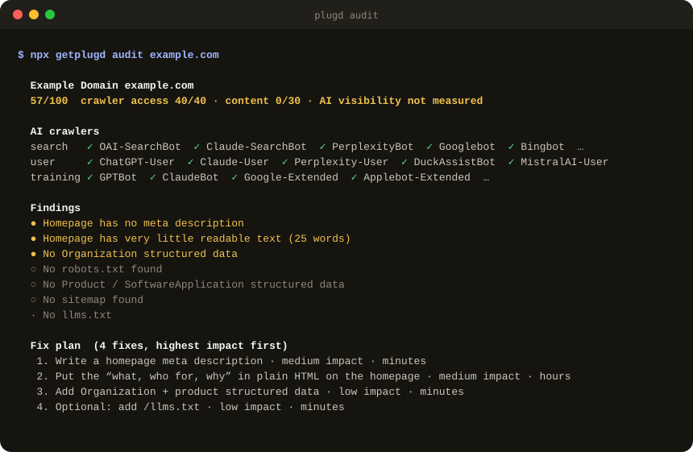

<p align="center">
  <a href="https://plugd.getplugd.workers.dev">
    <picture>
      <source media="(prefers-color-scheme: dark)" srcset=".github/assets/plugd-logo-dark.svg">
      
    </picture>
  </a>
</p>

<p align="center">
  <a href="https://www.npmjs.com/package/getplugd"></a>
  <a href="LICENSING.md"></a>
</p>

<h3 align="center">Open-source AI visibility tools: see what ChatGPT, Claude, Gemini and Perplexity say about your brand, then fix it.</h3>

<p align="center">
  Audit whether AI search engines can read your site, track how often they recommend you, and let your coding agent apply the fixes.<br>
  Free, local, and on your own API key.
</p>

<p align="center">
  <a href="docs/README.md"><strong>Explore the docs »</strong></a>
</p>

<p align="center">
  <a href="docs/tutorials/first-audit.md">Quickstart</a> ·
  <a href="docs/reference/cli.md">CLI</a> ·
  <a href="docs/how-to/run-weekly-in-github-actions.md">GitHub Action</a> ·
  <a href="docs/how-to/use-with-coding-agents.md">MCP server</a> ·
  <a href="#skills-for-your-coding-agent">Skills</a> ·
  <a href="https://plugd.getplugd.workers.dev">Plugd Cloud</a>
</p>

<br>

<p align="center"><strong>Checks what these AI engines say about you:</strong></p>
<p align="center">
  <a href="docs/reference/engines.md#chatgpt" title="ChatGPT"></a>
  <a href="docs/reference/engines.md#claude" title="Claude"></a>
  <a href="docs/reference/engines.md#gemini" title="Gemini"></a>
  <a href="docs/reference/engines.md#perplexity" title="Perplexity"></a>
</p>

<p align="center"><strong>Works with your coding agent and CI:</strong></p>
<p align="center">
  <a href="docs/how-to/use-with-coding-agents.md#claude-code" title="Claude Code"></a>
  <a href="docs/how-to/use-with-coding-agents.md#codex" title="Codex"></a>
  <a href="docs/how-to/use-with-coding-agents.md#cursor" title="Cursor"></a>
  <a href="docs/how-to/use-with-coding-agents.md#opencode" title="OpenCode"></a>
  <a href="docs/reference/mcp-tools.md" title="MCP server"></a>
  <a href="docs/how-to/run-weekly-in-github-actions.md" title="GitHub Actions"></a>
</p>

<br>

<p align="center">
  
</p>

## What Plugd does

When people ask ChatGPT, Claude, Gemini or Perplexity *"what's the best tool for…"*, the answer names a few brands and cites a few sources. Plugd shows you whether you're one of them, and what to change if you're not. This is also called **AEO** (answer engine optimization), **GEO** (generative engine optimization) or **AI SEO**.

| | Command | What you get |
|---|---|---|
| **Audit** | `npx getplugd audit yoursite.com` | Whether 21 AI crawlers can read your site (robots.txt *and* your CDN/firewall), plus content and structured-data checks and a score |
| **Fix** | `npx getplugd plan yoursite.com` | A ranked fix plan with ready-to-paste code: a corrected robots.txt, meta tags, JSON-LD, page outlines and outreach targets |
| **Track** | `npx getplugd track yoursite.com` | Your buyer questions asked to each engine with live web search, saved to `.plugd/`. Run it weekly to see the trend |
| **Report** | `npx getplugd report` | How often each engine names and cites you, with honest error ranges, who it names instead, and which sources it trusts |
| **Agent** | `npx getplugd mcp` | An MCP server so Claude Code, Codex, Cursor or OpenCode can audit, track and fix your site in your repo |
| **CI** | `uses: mdayan8/plugd@v1` | A GitHub Action that tracks weekly, commits the history and opens an issue when AI starts naming you less |

## Quick start

```bash
# 1. Can AI search engines read your site? (free, no key)
npx getplugd audit yoursite.com

# 2. What do the engines actually say? (your own key)
export GEMINI_API_KEY=...            # https://aistudio.google.com/apikey
npx getplugd track yoursite.com

# 3. See the trend, run after run
npx getplugd report
```

New here? Follow the [5-minute first audit](docs/tutorials/first-audit.md), then [track your visibility](docs/tutorials/track-your-visibility.md).

**Keys and cost.** Your keys go straight to Google or OpenRouter, never to us. Every paid run shows an estimate and asks first, and `--max-cost` hard-caps it. Gemini's search grounding needs billing turned on in Google Cloud; the first 5,000 searches a month are free. Details: [Get your API keys](docs/how-to/get-api-keys.md) and [Control what you spend](docs/how-to/control-costs.md).

## Use it from your coding agent

Install the Claude Code plugin for the MCP server plus all six skills:

```
/plugin marketplace add mdayan8/plugd
/plugin install plugd@plugd
```

Then ask: *"Audit our site for AI visibility and fix what you can in this repo."*

Codex, Cursor and OpenCode setup: [Use Plugd with your coding agent](docs/how-to/use-with-coding-agents.md). The four MCP tools are `audit_site`, `get_fix_plan`, `track_questions` and `get_history` ([reference](docs/reference/mcp-tools.md)).

## Track every week with GitHub Actions

```yaml
# .github/workflows/ai-visibility.yml
on:
  schedule: [{ cron: '0 6 * * 1' }]   # Mondays
permissions: { contents: write, issues: write }
jobs:
  track:
    runs-on: ubuntu-latest
    steps:
      - uses: actions/checkout@v4
      - uses: mdayan8/plugd@v1
        with:
          site: yoursite.com
          gemini-api-key: ${{ secrets.GEMINI_API_KEY }}
```

Full guide and every input: [Run Plugd weekly in GitHub Actions](docs/how-to/run-weekly-in-github-actions.md).

## Skills for your coding agent

Playbooks your agent can follow, built from vendor docs and published research. Every claim links to its source, and myths are labelled as myths.

| Skill | Use it when |
|---|---|
| [ai-visibility-audit](skills/ai-visibility-audit/SKILL.md) | You want the full picture and a ranked list of what to fix first |
| [ai-crawler-access](skills/ai-crawler-access/SKILL.md) | AI bots can't read the site: robots.txt, CDN/WAF blocking, JavaScript rendering |
| [structured-data](skills/structured-data/SKILL.md) | Adding or fixing JSON-LD (Organization, Product, Article…) |
| [answer-engine-content](skills/answer-engine-content/SKILL.md) | Writing pages AI engines quote and cite |
| [ai-citation-outreach](skills/ai-citation-outreach/SKILL.md) | Getting mentioned on the sites AI already trusts |
| [ai-visibility-tracking](skills/ai-visibility-tracking/SKILL.md) | Measuring share of voice without fooling yourself |

Also: [system prompts](prompts/) for agents, page drafting and outreach, and the [evidence brief](research/evidence-2026-10.md) behind every rule.

## What actually works (and what doesn't)

Short version of the [research](research/evidence-2026-10.md), with sources in [What works in AI search](docs/explanation/what-works-in-ai-search.md):

- **Being readable comes first.** Blocking `OAI-SearchBot` removes you from ChatGPT search, and blocking `Googlebot` removes you from AI Overviews. A CDN can block bots even when robots.txt allows them. Most AI crawlers don't run JavaScript.
- **Mentions on other sites matter more than links.** Branded mentions correlate about 3× more with AI visibility than backlinks do.
- **Not levers:** llms.txt (Google doesn't use it; 97% of files got zero requests in a month), schema markup on its own, "chunking" content for AI, and fixed passage lengths.
- **Answers vary a lot run to run.** So Plugd reports rates with error ranges, never a "position", and labels every answer as coming from the API.

## Open source and Plugd Cloud

| | Open source (this repo) | [Plugd Cloud](https://plugd.getplugd.workers.dev) |
|---|---|---|
| Audit, fix plan, MCP, skills | ✅ | ✅ |
| Tracking | You run it: locally, cron or GitHub Actions | Runs for you on a schedule |
| API keys | Your own | None needed |
| History | Files in your repo | Dashboard with your team |
| Your market's benchmark (who AI recommends in your niche) | — | ✅ |
| Price | Free (you pay your provider) | Plans from $29/month |

Plugd Cloud is in early access: [join the waitlist](https://plugd.getplugd.workers.dev/#cta).

## FAQ

<details>
<summary><strong>How do I get my brand recommended by ChatGPT?</strong></summary>

Make sure ChatGPT can read your site (allow `OAI-SearchBot` and check your CDN), publish pages that answer the questions buyers ask (comparisons, "best X for Y", pricing), and get mentioned on the third-party pages ChatGPT already cites. `npx getplugd audit` checks the first, and `track` + `report` show you the questions and sources for the rest. See [What works in AI search](docs/explanation/what-works-in-ai-search.md).
</details>

<details>
<summary><strong>What is AEO or GEO?</strong></summary>

Answer engine optimization (AEO) and generative engine optimization (GEO) are names for making a site easy for AI assistants to find, quote and recommend. The fundamentals overlap heavily with SEO: be crawlable, indexed and genuinely useful, and be talked about elsewhere.
</details>

<details>
<summary><strong>Does llms.txt help me get cited?</strong></summary>

No evidence says it does for AI search. Google says it doesn't use it, and a study found 97% of llms.txt files got zero requests in a month. It can help coding agents read developer docs. Plugd lists it as optional and never scores it.
</details>

<details>
<summary><strong>Does Plugd check the real ChatGPT app?</strong></summary>

No. The open-source tools ask each engine's API with web search turned on, and every answer is labelled as API data. API answers can differ from what people see in the app, so treat them as a consistent trend line rather than an exact copy of the app.
</details>

<details>
<summary><strong>How much does tracking cost?</strong></summary>

With Gemini, each question costs a fraction of a cent in tokens plus about two Google searches. The first 5,000 searches a month are free on a billed Google Cloud project, then $14 per 1,000. Through OpenRouter, it's about $0.01 per answer. `track` shows an estimate first, and `--max-cost` caps every run.
</details>

<details>
<summary><strong>Is my API key safe?</strong></summary>

Keys are read from your environment (or a GitHub secret) and sent only to the provider's API. Plugd has no server in the open-source tools and never receives them.
</details>

## Contributing

Issues and pull requests are welcome. For skills and research, every claim needs a source link. Contributions are accepted under the license of the part they change ([LICENSING.md](LICENSING.md)). Developer setup:

```bash
pnpm install && pnpm build && pnpm test
```

Repo layout, architecture and conventions: [CLAUDE.md](CLAUDE.md) and [docs/reference](docs/reference/).

## License

The code (CLI, MCP server, engines, GitHub Action) is [AGPL-3.0](LICENSE): free to use for your own sites and in your CI with no strings attached. If you run a modified version as a service for others, you share your changes. The skills, prompts and research are [MIT](skills/LICENSE): copy them anywhere. Details: [LICENSING.md](LICENSING.md).
